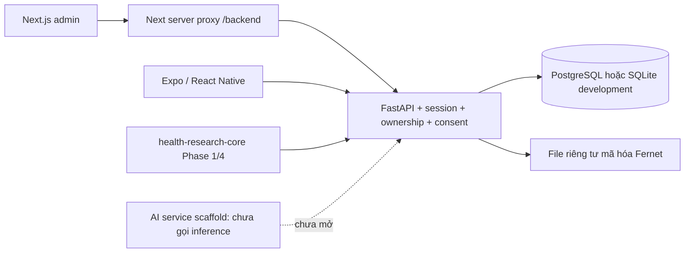

# Module 01 — kiến trúc hiện tại

`packages/health-core` đóng gói parser/review và engine tiến trình từ nghiên cứu. API không
phụ thuộc đường dẫn workspace cha hoặc import PyTorch/Paddle. Snapshot có hash nguồn và bản đóng gói.
`me/*` luôn suy ra chủ sở hữu từ session DB. Header/client không được chọn role hoặc subject.

Web dành cho quản trị, cookie HttpOnly/CSRF qua proxy cùng origin; native dùng bearer trong
SecureStore. Admin API chỉ có aggregate và tài khoản; hồ sơ hỗ trợ chỉ đọc cần consent đang có hiệu lực.
UI route groups chỉ là tổ chức màn hình; kiểm tra quyền thực nằm ở API.

Không có hội thoại/LLM, OCR production hoặc CV được bật. Không dùng model để tự sửa số đo/mục tiêu.
