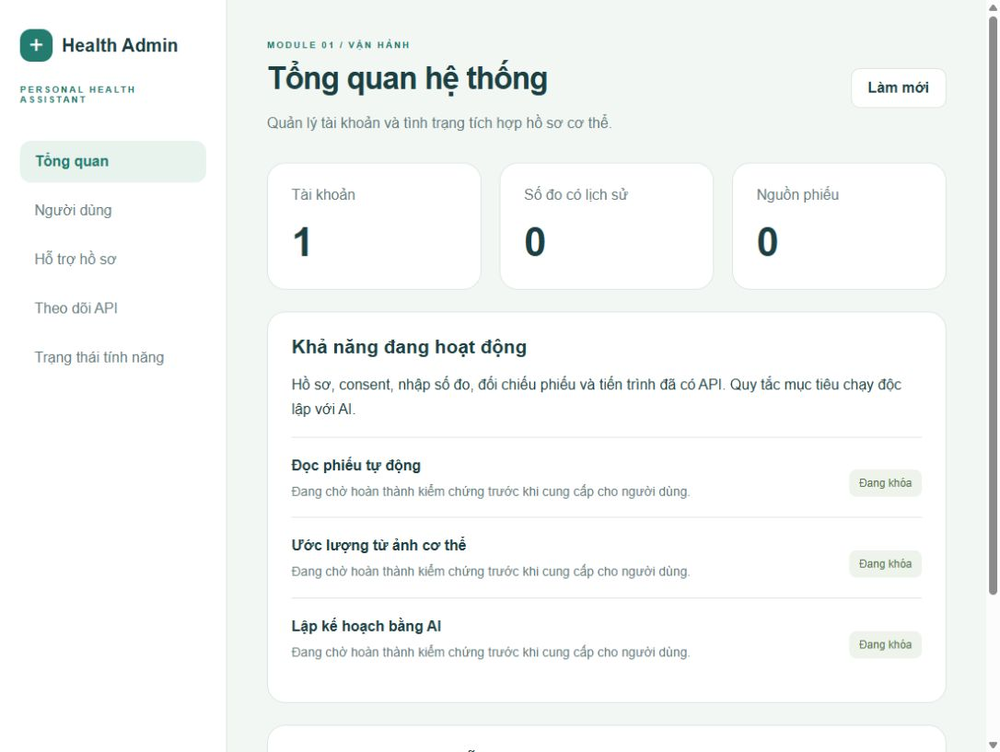

# Phase 5 — Module 01 integration MVP

Ngày kiểm tra: 22/10/2026. Đã triển khai và chạy thử **cục bộ**; chưa đóng các điều kiện phát hành production.

## Thành phần hoạt động

- API/session/ownership, admin/user, consent theo purpose/version, role không lấy từ client.
- SQLite + Alembic để chạy local; schema PostgreSQL và Compose đã chuẩn bị nhưng chưa chạy runtime.
- Payload sức khỏe/audit và file nguồn mã hóa authenticated; protected download, retention task,
  xuất tài khoản và xóa có re-authentication.
- Profile/context có version; observations có capture/ingestion time, unit, method, device/protocol,
  immutable corrections và provenance. Tiến trình dùng core Phase 4, không đổi logic nghiên cứu.
- Phiếu chép thủ công ở pending state; chọn trường, đối chiếu nguồn và acknowledge flags trước confirm.
  Một nguồn chỉ confirm một lần, atomic lock chống replay/nhiều drafts. Verified manual/report không bị ML ghi đè.
- Goal cân nặng có approval, source selection, safety screening độc lập và lịch sử. Unknown không thành no.
- App React Native có các màn hình trên; web quản trị có aggregate/users/consented support profile/API metrics.

## Bằng chứng đã chạy

| Kiểm tra | Kết quả |
|---|---|
| API integration/security tests | 25 passed |
| HTTP demo qua API server thật | 21 bước passed; account/file giả lập đã xóa |
| TypeScript | web + mobile + shared contracts passed |
| Next.js production build | passed |
| Expo export Hermes | Android + iOS passed; chưa phải APK/IPA cài thử |
| Alembic SQLite | upgrade head + check không có drift |
| Compose | config hợp lệ; daemon Docker Desktop hiện tắt |
| Browser UI | login, dashboard, danh sách users có support disabled, logout passed |
| Research snapshot | 12 file đóng gói/7 file nguồn kiểm tra hash |
| CNN mặc định | checkpoint và config hash khớp Phase 3; không thay đổi |

[HTTP result](http-smoke.json), [verification metadata](verification.json).
Ảnh dưới chụp bằng tài khoản quản trị giả lập trong lúc kiểm tra; tài khoản đó đã xóa, không phải tài khoản để đăng nhập.

## Chưa cung cấp

OCR inference tự động vẫn trả 409; chưa có benchmark InBody thật để mở tính năng. Review dùng bản chép thủ công,
không gọi nó là kết quả OCR. CV chưa mở vì uncertainty gate Phase 3 và real-capture/RGB validation chưa đạt.
AI service/LLM vẫn scaffold, chưa gọi inference production hay sinh kế hoạch. Model mặc định nghiên cứu giữ nguyên.

Chưa kiểm thử trên điện thoại/emulator; bundle chỉ xác minh đóng gói JS/Hermes. Chưa chạy PostgreSQL/Docker,
load/concurrency hoặc clinical/security release review. Metrics hiện là counters theo process, không có alert/SLO,
backup/key rotation/distributed quotas production. `deploy.yml` vẫn placeholder, không deploy/cloud upload.

Các features ngoài Module 01 và mục tiêu ngoài cân nặng tiếp tục nằm trong roadmap.
Dùng [README chạy thử](../../README.md), [API](../api/module-01.md), [privacy](../security/access-control.md),
[goal rules](../ai-design/goal-screening.md) và [phần còn lại](../roadmap/README.md).
