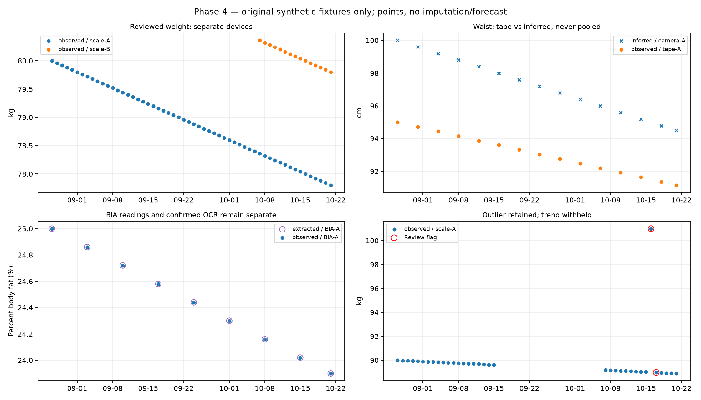

# Phase 4 — Body Progress Intelligence

**Original synthetic fixtures only; real longitudinal subjects: 0.**

Records: 193; subjects: 5; source-isolated streams: 12.
As-of: 2026-10-22T00:00:00+07:00; reporting timezone: Asia/Bangkok.

## Known-trend check

Synthetic scale-A expected slope: -0.280 kg/week; recovered: -0.280 kg/week.
This validates elapsed-day handling/unit normalization on a controlled fixture, not health effectiveness or a weight-loss recommendation.

## Stream results

| Subject | Field | Provenance | Device | Value days | 28-day slope/week | Status / reasons |
|---|---|---|---|---:|---:|---|
| synthetic-conflict | weight_kg | observed | scale-A | 0 | N/A | withheld; insufficient_temporal_support, stale_or_missing |
| synthetic-review | weight_kg | observed | scale-A | 35 | N/A | withheld; rapid_change_review |
| synthetic-sparse | weight_kg | observed | scale-A | 3 | N/A | withheld; insufficient_temporal_support |
| synthetic-stale | weight_kg | observed | scale-A | 10 | N/A | withheld; insufficient_temporal_support, stale_or_missing |
| synthetic-steady | percent_body_fat | extracted | BIA-A | 9 | -0.140 | descriptive_only;  |
| synthetic-steady | percent_body_fat | observed | BIA-A | 9 | -0.140 | descriptive_only;  |
| synthetic-steady | skeletal_muscle_mass_kg | observed | BIA-A | 9 | 0.035 | descriptive_only;  |
| synthetic-steady | waist_cm | inferred | camera-A | 15 | N/A | withheld; source_not_reviewed_measurement |
| synthetic-steady | waist_cm | observed | tape-A | 15 | -0.490 | descriptive_only;  |
| synthetic-steady | weight_kg | extracted | BIA-A | 9 | N/A | withheld; source_not_reviewed_measurement |
| synthetic-steady | weight_kg | observed | scale-A | 56 | -0.280 | descriptive_only;  |
| synthetic-steady | weight_kg | observed | scale-B | 15 | -0.280 | descriptive_only;  |

## Quality / governance

Analysis states: `{'active': 186, 'duplicate_event': 1, 'superseded': 1, 'duplicate_copy': 1, 'not_yet_recorded': 2, 'quarantined_conflicting_id': 2}`.
Raw audit retained. Revisions do not rewrite originals; conflicting IDs and revision branches are quarantined. Pending/future knowledge cannot replace reviewed data.
Confirmed OCR stays extracted; inferred/pending/self-declared values cannot feed reviewed-measurement trends or planner facts.
No interpolation/forward-fill. Calendar gaps report absence of data, not non-adherence. Percent-body-fat differences use percentage points.
Source/device/protocol/model versions split streams. Multiple eligible streams require explicit source selection for planner facts.

## Dashboard / Planner

Subject-scoped dashboard payload excludes raw audit and other subjects. Planner context exports facts only, no plan or goal changes.
`plan_generation_authorized=false`; safety screening, user goal approval, authenticated access and real consent store remain Phase 5 gates.

## Limits

BodyM has repeated photos, not verified longitudinal sessions. No dates were inferred from photo order and no real InBody history was fabricated.
Rules are fixed engineering review heuristics, not clinical safety thresholds. Theil-Sen slopes are descriptive, not forecasts or validated probability of progress.
Real longitudinal benchmark, device repeatability/noise assessment and user-facing integration remain unvalidated.
The Phase 3 uncertainty gate remains unmet; Phase 4 does not turn inferred predictions into observed progress.

Method reference: [SciPy Theil-Sen](https://docs.scipy.org/doc/scipy/reference/generated/scipy.stats.theilslopes.html).
