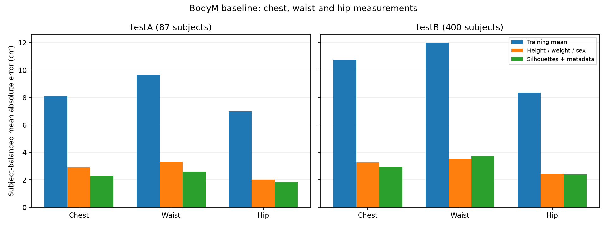

# BodyM baseline run

Fit: 1614 subjects; validation: 404 subjects.

Targets: chest, waist, hip (cm). Test models refitted on all 2,018 training subjects.

MAE below gives each subject equal weight, including subjects with multiple photos.

| Model | Split | Chest MAE (cm) | Waist MAE (cm) | Hip MAE (cm) | Mean MAE (cm) |
| --- | --- | ---: | ---: | ---: | ---: |
| mean_baseline | validation | 8.188 | 9.712 | 6.783 | 8.227 |
| mean_baseline | testA | 8.070 | 9.631 | 7.010 | 8.237 |
| mean_baseline | testB | 10.775 | 11.999 | 8.355 | 10.376 |
| metadata_ridge | validation | 2.872 | 3.478 | 2.292 | 2.881 |
| metadata_ridge | testA | 2.903 | 3.306 | 2.018 | 2.742 |
| metadata_ridge | testB | 3.277 | 3.561 | 2.446 | 3.095 |
| silhouette_metadata_ridge | validation | 2.236 | 2.788 | 1.957 | 2.327 |
| silhouette_metadata_ridge | testA | 2.284 | 2.613 | 1.840 | 2.246 |
| silhouette_metadata_ridge | testB | 2.952 | 3.719 | 2.399 | 3.023 |

Limitations:
- Uses supplied height, weight and sex metadata as inputs; this is not an image-only model.
- Uses simple silhouette profiles and Ridge regression, not the published BMnet model.
- Original testA and testB share one subject ID; report their results separately.
- Does not predict InBody values, body-fat percentage or skeletal muscle mass.
- The score is an initial experiment, not a clinical validation.
