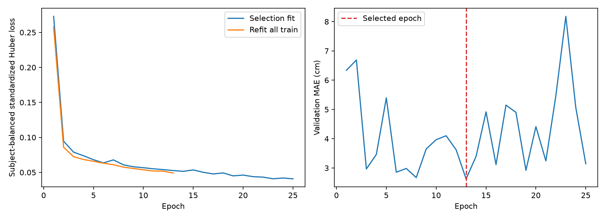
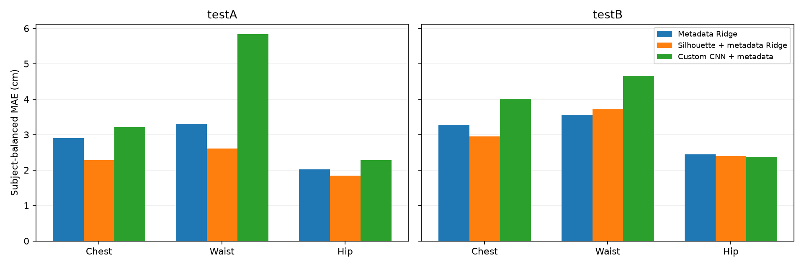

# BodyM custom CNN

Two silhouette views share a four-block CNN (16/32/64/128 channels, BatchNorm, ReLU, MaxPool, Global Average Pooling).
Height, weight and sex pass through a 3 -> 32 -> 16 MLP; fusion is 272 -> 128 -> 64 -> 3 with dropout.

Device: NVIDIA GeForce RTX 4060; parameters: 141,443; selected epoch: 13.

The best epoch is selected using the same 1,614/404-subject fit/validation split as Ridge.
The network is then initialized again and trained on all 2,018 train subjects for that many epochs.
Metadata and targets are normalized using only the training subjects of each phase.
Huber loss and MAE give each subject equal total weight. TestA and testB remain separate.

| Model | Split | Chest MAE (cm) | Waist MAE (cm) | Hip MAE (cm) | Mean MAE (cm) |
| --- | --- | ---: | ---: | ---: | ---: |
| metadata_ridge | validation | 2.872 | 3.478 | 2.292 | 2.881 |
| metadata_ridge | testA | 2.903 | 3.306 | 2.018 | 2.742 |
| metadata_ridge | testB | 3.277 | 3.561 | 2.446 | 3.095 |
| silhouette_metadata_ridge | validation | 2.236 | 2.788 | 1.957 | 2.327 |
| silhouette_metadata_ridge | testA | 2.284 | 2.613 | 1.840 | 2.246 |
| silhouette_metadata_ridge | testB | 2.952 | 3.719 | 2.399 | 3.023 |
| two_view_cnn | validation | 2.629 | 2.937 | 2.322 | 2.629 |
| two_view_cnn | testA | 3.204 | 5.831 | 2.281 | 3.772 |
| two_view_cnn | testB | 4.000 | 4.661 | 2.371 | 3.677 |

This is one initial run of a custom architecture. Inputs include supplied metadata and binary silhouettes.
Original testA and testB share one subject ID. The model predicts circumferences, not InBody fat/muscle values.
