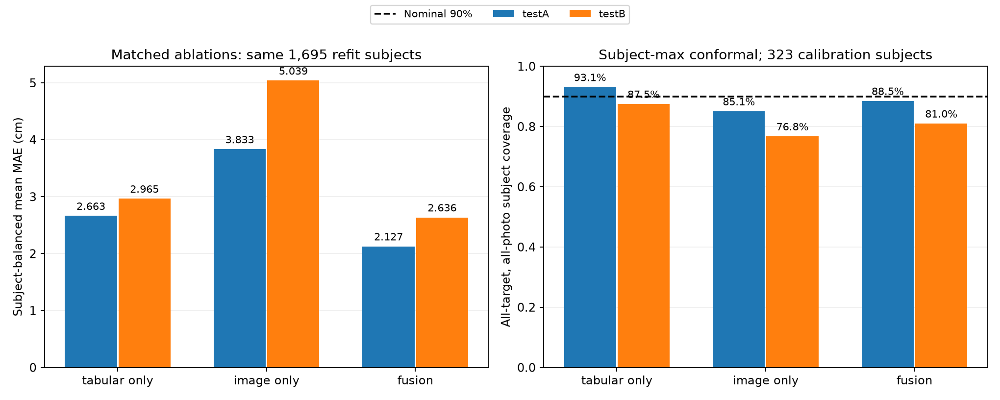

# Phase 3 — Multimodal ablation & uncertainty

Các checkpoint nghiên cứu mới; model mặc định Phase 2 giữ nguyên.

## Protocol

Proper fit: 1291; tuning: 404; calibration: 323 người.
Mỗi biến thể chọn epoch bằng tuning rồi refit trên 1695 người proper-fit+tuning, loại calibration.
Outer train/testA/testB giữ nguyên. testA/testB chung 1 subject ID, báo riêng.
Tabular-only/image-only thực sự bỏ nhánh còn lại; không dùng zero-mask để giả lập ablation.
Model default đã học cả 2.018 người nên không dùng calibrator mới cho checkpoint đó.

## Point errors — subject-balanced, cm

| Variant | Parameters | Best epoch | Tune MAE | Test | Chest MAE | Waist MAE | Hip MAE | Mean MAE |
|---|---:|---:|---:|---|---:|---:|---:|---:|
| tabular_only | 11283 | 21 | 2.796 | testA | 2.924 | 3.209 | 1.857 | 2.663 |
| tabular_only | 11283 | 21 | 2.796 | testB | 3.122 | 3.441 | 2.332 | 2.965 |
| image_only | 138739 | 15 | 4.235 | testA | 4.114 | 3.648 | 3.738 | 3.833 |
| image_only | 138739 | 15 | 4.235 | testB | 4.995 | 5.510 | 4.612 | 5.039 |
| fusion | 141443 | 58 | 2.375 | testA | 2.372 | 2.434 | 1.576 | 2.127 |
| fusion | 141443 | 58 | 2.375 | testB | 2.771 | 2.996 | 2.141 | 2.636 |

## Intervals — nominal 90%

Calibration score: max absolute error qua mọi ảnh của mỗi người. Dùng order statistic ceil((n+1)×(1−alpha)), không dùng quantile n thông thường.
Per-target radii dành cho từng chu vi; joint radius là max qua cả ba chu vi để đánh giá đồng thời.
Độ bao phủ dưới đây đòi hỏi mọi ảnh của người đó đều được bao phủ; pair coverage và width riêng có trong metrics JSON.

| Variant | Test | Chest coverage | Waist coverage | Hip coverage | Joint coverage | Joint full width (cm) |
|---|---|---:|---:|---:|---:|---:|
| tabular_only | testA | 86.2% | 96.6% | 95.4% | 93.1% | 16.083 |
| tabular_only | testB | 86.5% | 90.8% | 87.0% | 87.5% | 16.083 |
| image_only | testA | 72.4% | 87.4% | 85.1% | 85.1% | 25.304 |
| image_only | testB | 75.2% | 77.0% | 84.0% | 76.8% | 25.304 |
| fusion | testA | 74.7% | 79.3% | 78.2% | 88.5% | 14.864 |
| fusion | testB | 82.5% | 81.2% | 83.5% | 81.0% | 14.864 |

Khoảng rộng không tự chứng minh hữu ích; đọc coverage cùng width. Target 90% là mức danh nghĩa, không phải xác suất đúng cho từng người.
Số ảnh/người và điều kiện chụp giữa calibration/test khác nhau; đặc biệt testA có nhiều ảnh/người hơn. Không khẳng định bảo đảm coverage ngoài miền.

## Novelty / OOD heuristic

Median/IQR-distance trên 19 features (metadata + hình học silhouette), chỉ fit 1 ảnh/người ở proper-fit.
Threshold là quantile 99% train; thêm cờ metadata ngoài min/max train. Không học từ calibration/test.
Không có nhãn OOD thật nên chưa có AUROC/recall hoặc ngưỡng an toàn được kiểm chứng.

| Test | Flagged pairs | All pairs | Subjects with any flag |
|---|---:|---:|---:|
| testA | 22 | 1684 | 2 |
| testB | 6 | 1160 | 2 |

Cờ không loại trường hợp khỏi overall metrics. Flagged/unflagged errors và intervals có trong metrics JSON; khi chỉ giữ một số ảnh thì coverage cũng chỉ áp dụng cho số ảnh đó.

## Error analysis & conclusion

- testA: fusion MAE 2.127 cm, joint coverage 88.5%.
- testB: fusion MAE 2.636 cm, joint coverage 81.0%.
- Fusion chưa đạt coverage danh nghĩa 90% trên hai test này: uncertainty deployment gate chưa qua. Không chọn radius lại dựa trên test; cần validation/calibration đại diện hơn và test mới.
- Khác biệt ba biến thể dùng cùng dữ liệu train/calibration là ablation nghiên cứu; một seed chưa chứng minh kết quả ổn định.
- Không so trực tiếp delta với checkpoint default như một cải thiện model: default học 2.018 người, các model mới chỉ refit trên 1.695.
- Data/architecture/test đã được xem ở các phase trước; không phải benchmark prospective hoàn toàn độc lập. Cần test mới trước phát hành.
- Các giá trị là inferred từ silhouette, chưa được người dùng xác minh; không dự đoán thành phần mỡ/cơ, không dùng cho chẩn đoán.
- Không tự chuyển model mặc định theo test. XGBoost/ViT, nhiều seed và dataset RGB ngoài miền chưa được đánh giá ở lượt này.

Tham khảo phương pháp: [Angelopoulos & Bates — conformal prediction](https://arxiv.org/abs/2107.07511).
